# SoftRenderer

用 C++ 在 CPU 上将 OBJ 三角网格渲染为图像。顶点变换、裁剪、覆盖测试、纹理采样、光照、阴影和后处理都在软件中执行。SDL2 显示最终帧，也可以直接导出 TGA。以下 22 张截图均由 Release x64 程序以 2160 × 1560 原生分辨率渲染。点击任意图片可查看完整尺寸的 PNG。

**人头像 · Phong 与物体空间法线**

[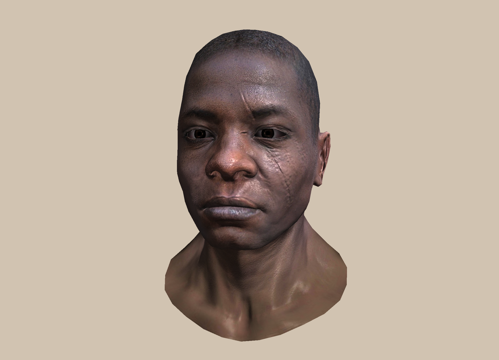](docs/screenshots/phong.png?raw=true)

**Diablo · 投影阴影与自发光**

[](docs/screenshots/shadow.png?raw=true)

**Flight Helmet · PBR**

[](docs/screenshots/helmet.png?raw=true)

## 构建与运行

在 Windows 的 **Developer PowerShell for VS 2022** 中从仓库根目录运行。需要 MSVC v143、Windows SDK 和「使用 C++ 的桌面开发」工作负载。GLM、SDL2、tinyobjloader、stb_image 和 TGA 读写代码随仓库提供。x64 构建会将 SDL2.dll 复制到可执行文件旁边。

```powershell
msbuild SoftRenderer.sln /m /p:Configuration=Release /p:Platform=x64
Set-Location SoftRenderer
$exe = ".\bin\x64\Release\SoftRenderer.exe"

& $exe --scene diablo --mode toon
& $exe --scene head --mode phong --normals object --size 2160x1560 --output head.tga
& $exe --scene diablo --mode shadow --ao ssao --output lit.tga --ao-map visibility.tga
& $exe --scene helmet --mode pbr --output helmet.tga
```

预设从当前工作目录下的 `resource/models` 加载资源。无参数时显示 1920 × 1080 的 Diablo 卡通场景，按 Esc 或关闭窗口退出。窗口模式写入 `output.tga`，启用后处理时另存 `postProcess.tga`。指定 `--output` 会直接写出最终帧并退出，适合批量截图。

也可以重复传入 `--model`，让多个 OBJ 共用相机和深度缓冲。自定义场景的镜头朝向原点，适合中心在原点、约两个单位高的教学模型。例如在上述工作目录执行：

```powershell
& $exe --model resource/models/head/head/african_head.obj --model resource/models/head/eye_inner/african_head_eye_inner.obj --mode normal --normals tangent --output normals.tga
& $exe --help
```

## 渲染特性

| 功能 | 实现 | 运行入口 |
| --- | --- | --- |
| 线框与三角形填充 | Bresenham 绘制相机投影后的网格边。包围盒和扫描线两种遍历方式共享覆盖测试，RGB 视图用三个顶点的颜色显示重心插值。 | `--mode wire`、`--mode barycentric --raster scanline` |
| 相机与深度 | 三角形先经过齐次空间六平面裁剪，再进行透视除法。浮点 Z-buffer 决定表面可见性，深度预览将当前可见范围映射为灰度。 | `--mode depth` |
| 光照 | Flat 使用面法线，Gouraud 插值顶点光照，逐像素着色使用插值法线。Phong 用反射向量计算高光，Blinn–Phong 使用半程向量。 | `flat`、`gouraud`、`smooth`、`phong`、`blinn` |
| 材质与法线 | 支持漫反射、高光、自发光，以及物体空间和切线空间法线贴图。可单独查看底色、发光区域或参与光照的世界空间法线。 | `--mode albedo`、`--mode emission`、`--mode normal --normals object` |
| 阴影与环境遮蔽 | 方向光阴影由光源视角的深度图生成。SSAO 和多方向采样 AO 均作用于首帧，可导出可见度图。 | `--mode lit` 对比 `--mode shadow`，后者可加 `--ao ssao` 或 `--ao brute` |
| 卡通与描边 | 三档光照生成色带，Sobel 算子从深度变化中提取轮廓。可以使用同一机位单独比较描边效果。 | `--mode toon --post none` 对比 `--mode toon` |

### 光栅化与深度

线框用 Bresenham 绘制每条三角形边，包括背面的边。彩色图将三个顶点分别设为红、绿、蓝，由片元对应的重心权重混色。两种填充路径共享像素中心覆盖测试、深度测试和属性插值。深度图中，最近的可见表面为黑色，最远为白色。

**Bresenham 线框**

[](docs/screenshots/wire.png?raw=true)

**RGB 重心插值**

[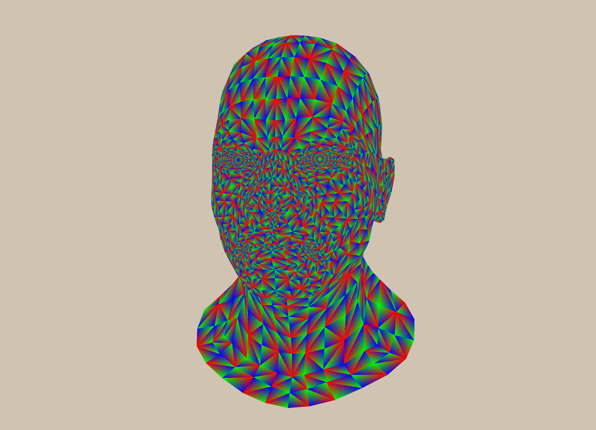](docs/screenshots/barycentric.png?raw=true)

**相机深度**

[](docs/screenshots/depth.png?raw=true)

### 光照与法线

Flat 每个三角形共用一个面法线，鼻梁和下颌的分面尤其明显。Gouraud 插值顶点的光照强度，`smooth` 在每个像素上归一化插值法线，再计算漫反射。三张法线图保持同一机位，将最终参与光照的世界空间法线编码为 RGB，便于检查眼窝、嘴唇和皮肤细节。

**Flat**

[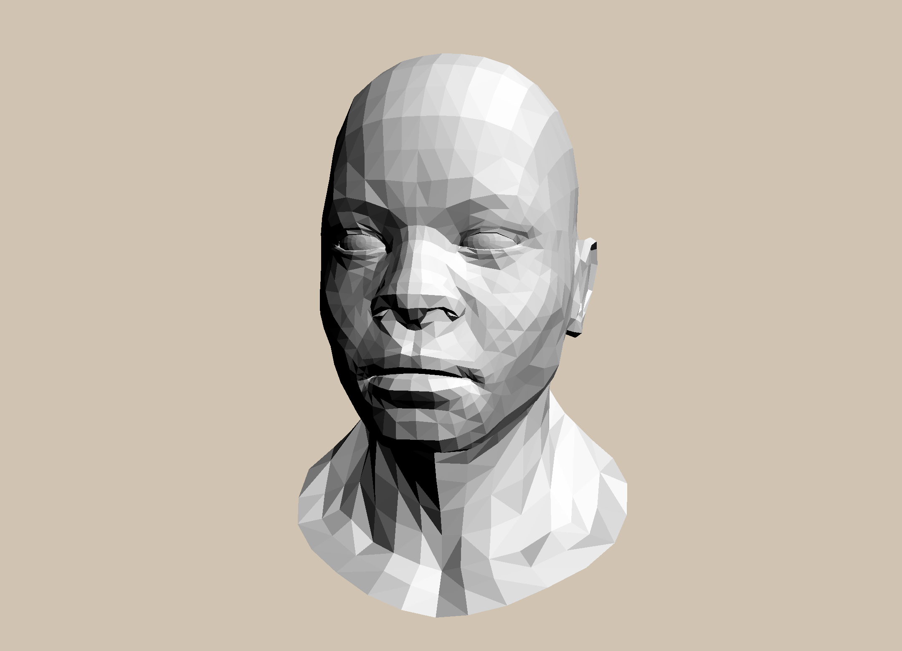](docs/screenshots/flat.png?raw=true)

**Gouraud**

[](docs/screenshots/gouraud.png?raw=true)

**逐像素漫反射**

[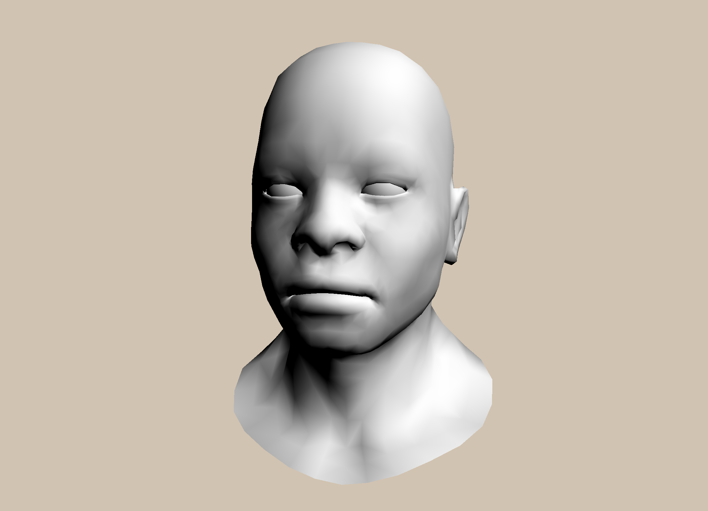](docs/screenshots/smooth.png?raw=true)

**顶点法线**

[](docs/screenshots/normal-vertex.png?raw=true)

**物体空间贴图**

[](docs/screenshots/normal-object.png?raw=true)

**切线空间贴图**

[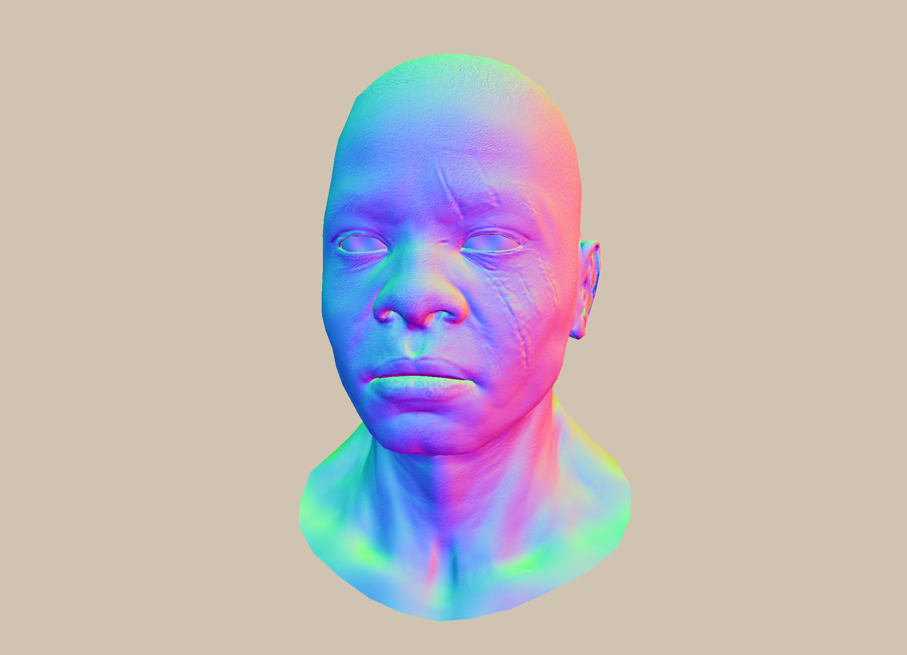](docs/screenshots/normal-tangent.png?raw=true)

### 材质、阴影与 AO

对没有 MTL 的 OBJ，加载器按同名后缀寻找 `_diffuse.tga` 或 `_diff.tga`、`_spec.tga`、`_nm.tga`、`_nm_tangent.tga` 和 `_glow.tga`。有 MTL 时可读取各面的材质及其贴图，包括 `map_Ke`。默认法线来源 `auto` 依次选择切线空间贴图、物体空间贴图、顶点法线。显式指定的贴图缺失时回退到顶点法线。

**漫反射贴图**

[](docs/screenshots/albedo.png?raw=true)

**自发光贴图**

[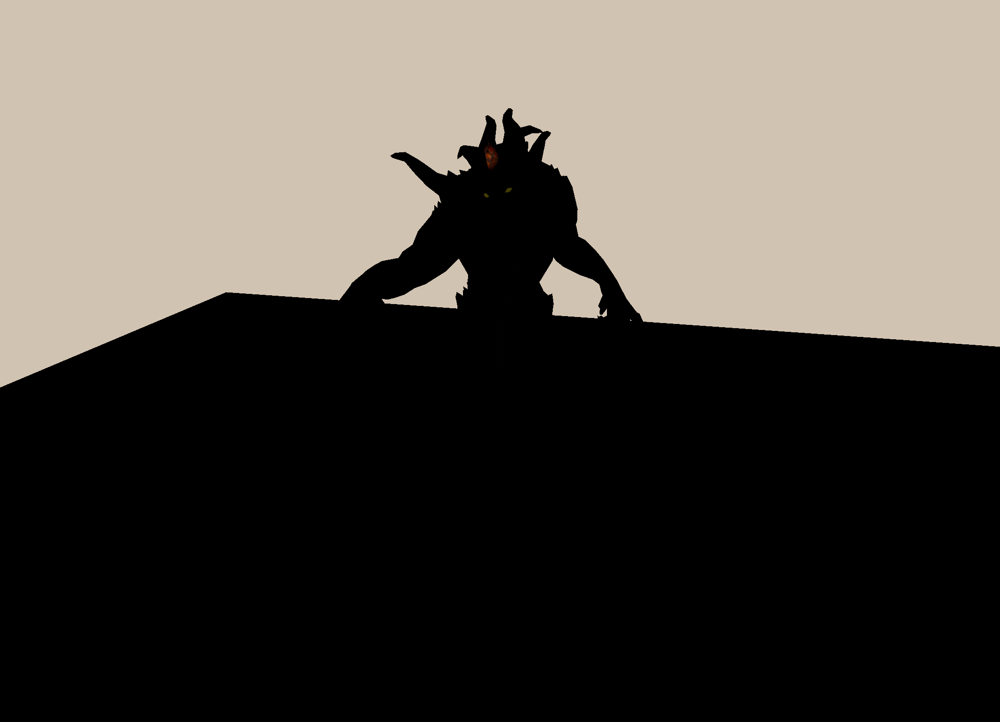](docs/screenshots/emission.png?raw=true)

**光照合成，关闭阴影**

[](docs/screenshots/lit.png?raw=true)

将页首的 Diablo 投影阴影图与上方关闭阴影的合成图对照，可以观察角色在脚下和身后留下的投影。`shadow` 和 `lit` 使用同一套材质与光照参数。AO 调制环境光，自发光独立叠加。下面两组大图依次展示 SSAO 和多方向 AO 的合成结果与可见度，白色表示开放、暗部表示遮蔽。

**SSAO · 每像素 128 个半球样本 · 最终帧**

[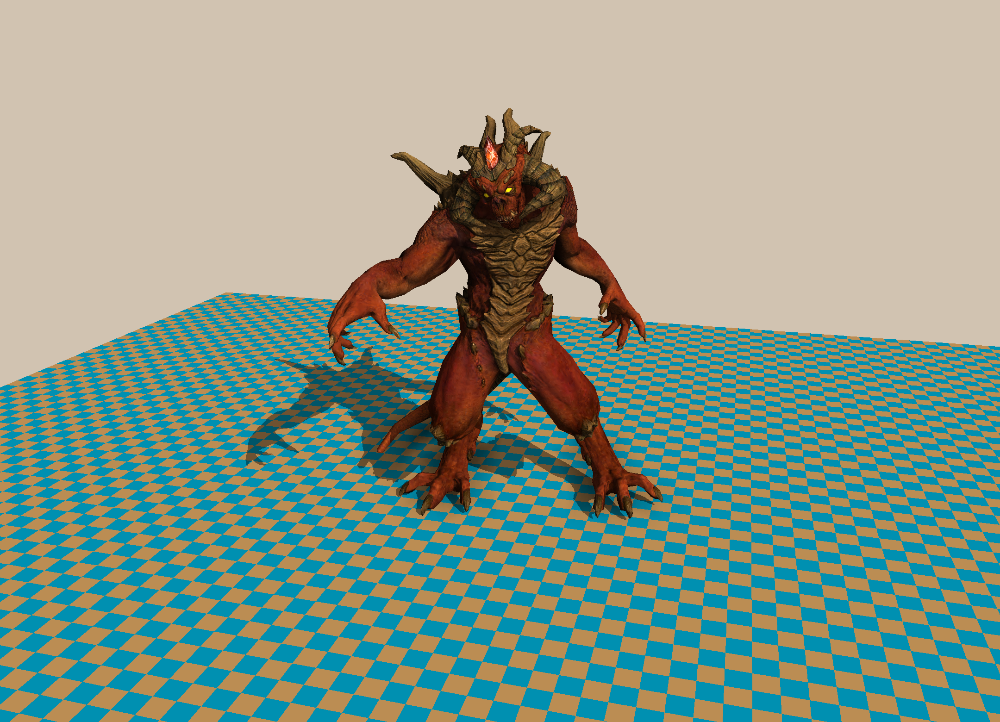](docs/screenshots/ssao.png?raw=true)

**SSAO · 每像素 128 个半球样本 · 可见度**

[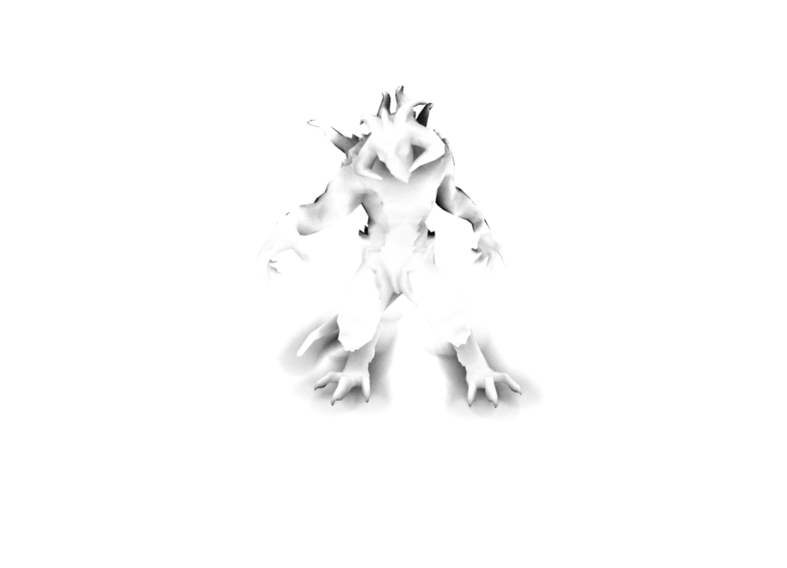](docs/screenshots/ssao-map.png?raw=true)

**多方向 AO · 256 张半分辨率深度图 · 最终帧**

[](docs/screenshots/brute.png?raw=true)

**多方向 AO · 256 张半分辨率深度图 · 可见度**

[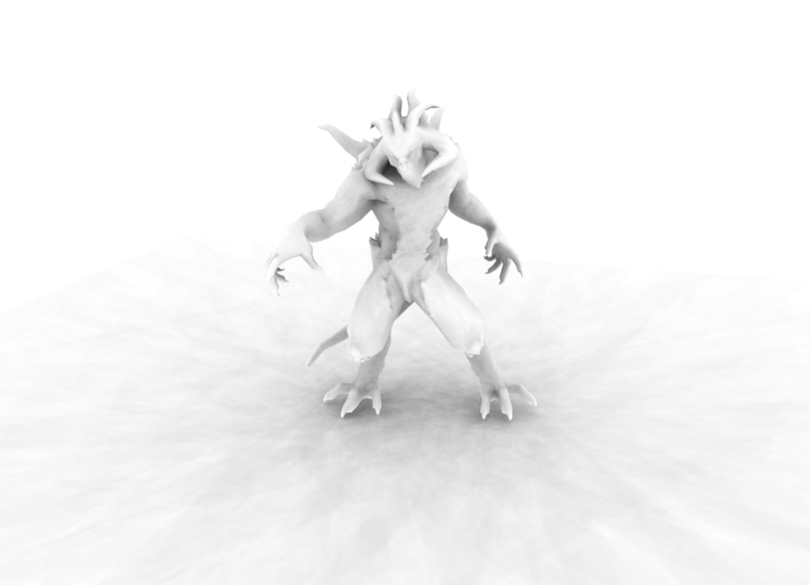](docs/screenshots/brute-map.png?raw=true)

SSAO 只利用相机当前可见的几何，多方向 AO 还会计入镜头外落在采样视锥内的遮挡物。两种方法均使用有限样本。预设适用于静态场景，方向光和多方向 AO 的正交采样范围针对原点附近的模型设置。

### 卡通与后处理

依次展示三档色带、在深度突变处叠加墨线后的效果，以及对阴影场景应用马赛克的结果。`--post` 也支持 `gray` 和 `rgb`。Flight Helmet 使用项目原有的 GGX 材质和打包的遮蔽、粗糙度、金属度贴图，效果见页首。

**三档色带**

[](docs/screenshots/bands.png?raw=true)

**Sobel 深度描边**

[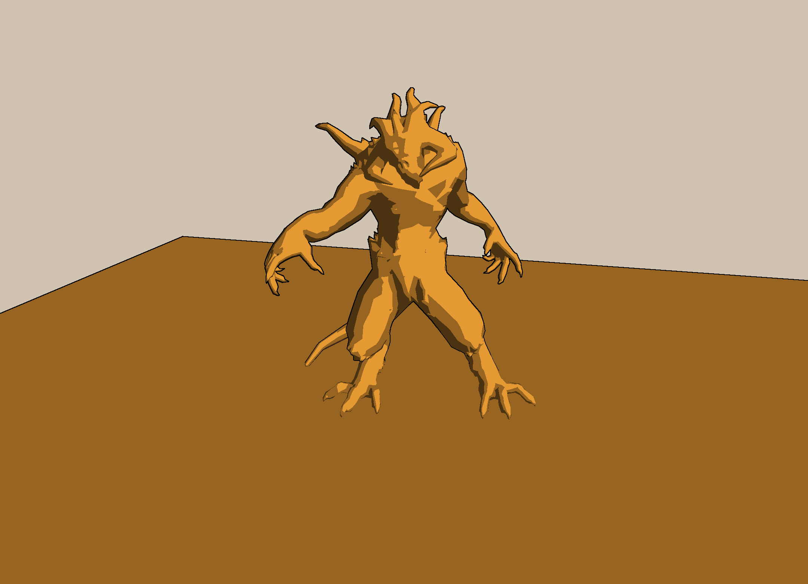](docs/screenshots/toon.png?raw=true)

**马赛克**

[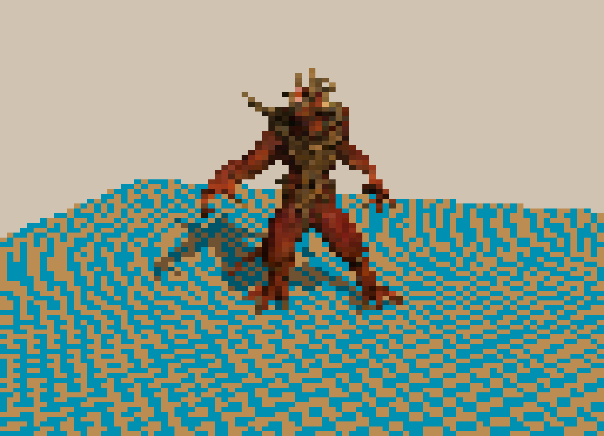](docs/screenshots/mosaic.png?raw=true)

## 复现截图与测试

在仓库根目录运行以下命令。画廊脚本调用同一个可执行文件导出 TGA，再用 Pillow 无损转为 PNG。回归测试覆盖 OBJ 遮挡顺序、近裁剪面、两种填充路径的像素一致性、法线贴图坐标系、灰度纹理、自发光、首帧 AO 和卡通描边。

```powershell
python -m pip install Pillow
python tests/render_smoke.py -v
python tools/gallery.py
```

渲染循环和 AO 计算位于 [Renderer.cpp](SoftRenderer/src/renderer/Renderer.cpp)，材质加载位于 [Model2.cpp](SoftRenderer/src/model2/Model2.cpp)，公共法线解码位于 [Shader.cpp](SoftRenderer/src/shader/Shader.cpp)。人头像由 Vidar Rapp 提供，Flight Helmet 由 Microsoft 提供，原始资源说明随模型保存。[人头像授权说明](SoftRenderer/resource/models/head/readme.txt) · [Flight Helmet 资源说明](SoftRenderer/resource/models/FlightHelmet/README.md)
