# SoftRenderer

用 C++ 在 CPU 上将 OBJ 三角网格渲染为图像。顶点变换、裁剪、覆盖测试、纹理采样、光照、阴影和后处理都在软件中执行。SDL2 显示最终帧，也可以直接导出 TGA。以下 36 张完整截图均由 Release x64 程序以 2160 × 1560 原生分辨率渲染，另附四张局部放大图，分别对比模型轮廓、投影边缘、脚掌接地处和自发光泛光。点击任意图片可查看完整尺寸的 PNG。

**人头像 · Phong 与物体空间法线**

[](docs/screenshots/phong.png?raw=true)

**Diablo · 投影阴影与自发光**

[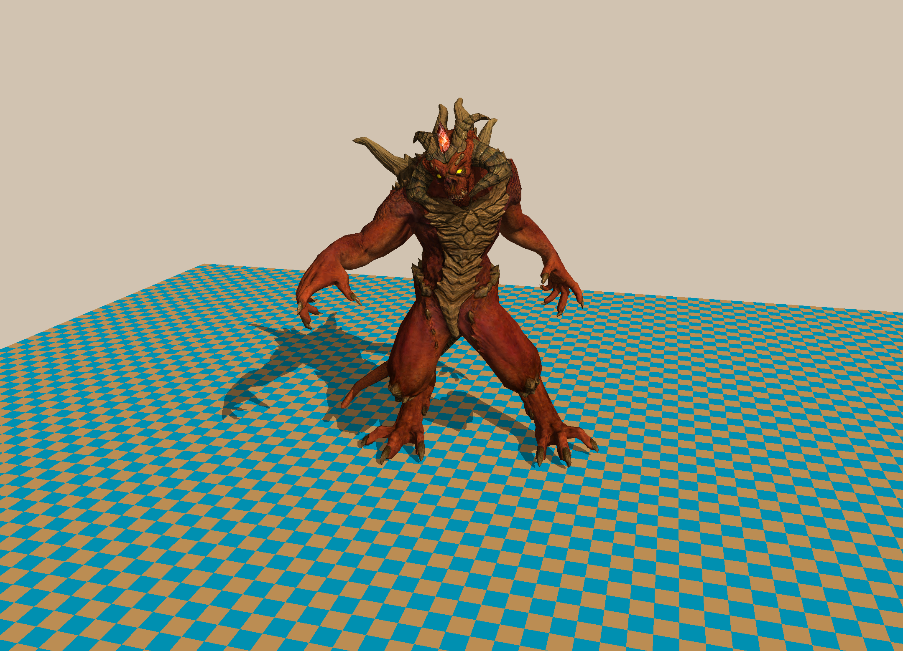](docs/screenshots/shadow.png?raw=true)

**Flight Helmet · PBR**

[](docs/screenshots/helmet.png?raw=true)

## 构建与运行

在 Windows 的 **Developer PowerShell for VS 2022** 中从仓库根目录运行。需要 MSVC v143、Windows SDK 和「使用 C++ 的桌面开发」工作负载。GLM、SDL2、tinyobjloader、stb_image 和 TGA 读写代码随仓库提供。x64 构建会将 SDL2.dll 复制到可执行文件旁边。

```powershell
msbuild SoftRenderer.sln /m /p:Configuration=Release /p:Platform=x64
Set-Location SoftRenderer
$exe = ".\bin\x64\Release\SoftRenderer.exe"

& $exe --scene diablo --mode toon
& $exe --scene head --mode phong --normals object --size 2160x1560 --output head.tga
& $exe --scene diablo --mode shadow --ao ssao --output lit.tga --ao-map visibility.tga
& $exe --scene helmet --mode pbr --output helmet.tga
```

预设从当前工作目录下的 `resource/models` 加载资源。无参数时显示 1920 × 1080 的 Diablo 卡通场景，按 Esc 或关闭窗口退出。窗口模式写入 `output.tga`，启用后处理时另存 `postProcess.tga`。指定 `--output` 会直接写出最终帧并退出，适合批量截图。

也可以重复传入 `--model`，让多个 OBJ 共用相机和深度缓冲。自定义场景的镜头朝向原点，适合中心在原点、约两个单位高的教学模型。例如在上述工作目录执行：

```powershell
& $exe --model resource/models/head/head/african_head.obj --model resource/models/head/eye_inner/african_head_eye_inner.obj --mode normal --normals tangent --output normals.tga
& $exe --help
```

## 渲染特性

| 功能 | 实现 | 运行入口 |
| --- | --- | --- |
| 线框与三角形填充 | Bresenham 绘制相机投影后的网格边。包围盒和扫描线两种遍历方式共享覆盖测试，RGB 视图用三个顶点的颜色显示重心插值。 | `--mode wire`、`--mode barycentric --raster scanline` |
| 相机与深度 | 三角形先经过齐次空间六平面裁剪，再进行透视除法。浮点 Z-buffer 决定表面可见性，深度预览将当前可见范围映射为灰度。 | `--mode depth` |
| 光照 | Flat 使用面法线，Gouraud 插值顶点光照，逐像素着色使用插值法线。Phong 用反射向量计算高光，Blinn–Phong 使用半程向量。 | `flat`、`gouraud`、`smooth`、`phong`、`blinn` |
| 材质与法线 | 支持漫反射、高光、自发光，以及物体空间和切线空间法线贴图。可单独查看底色、发光区域或参与光照的世界空间法线。 | `--mode albedo`、`--mode emission`、`--mode normal --normals object` |
| 纹理过滤 | 支持最近邻、双线性、单层 mipmap 与三线性。根据每个片元的屏幕空间 UV 梯度和当前贴图尺寸选择层级。 | `--filter nearest`、`bilinear`、`mipmap`、`trilinear` |
| 阴影与环境遮蔽 | 方向光使用独立分辨率的深度图，支持单点深度比较和 3×3 PCF。SSAO 和多方向采样 AO 均作用于首帧，可导出可见度图。 | `--mode lit` 对比 `--mode shadow`，后者可加 `--ao ssao` 或 `--ao brute` |
| HDR、曝光与 Bloom | 在线性浮点颜色上合成光照、自发光与泛光，可调整曝光后导出 sRGB 图像。 | `--hdr`、`--exposure -2`、`--emission-strength 64 --bloom 1` |
| 卡通与描边 | 三档光照生成色带，Sobel 算子从深度变化中提取轮廓。可以使用同一机位单独比较描边效果。 | `--mode toon --post none` 对比 `--mode toon` |

### 光栅化与深度

线框用 Bresenham 绘制每条三角形边，包括背面的边。彩色图将三个顶点分别设为红、绿、蓝，由片元对应的重心权重混色。两种填充路径共享采样点覆盖规则、深度测试和属性插值。深度图中，最近的可见表面为黑色，最远为白色。

**Bresenham 线框**

[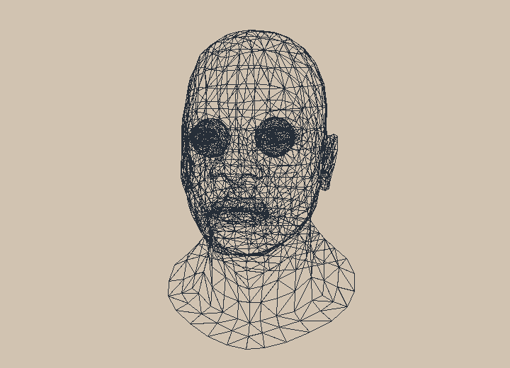](docs/screenshots/wire.png?raw=true)

**RGB 重心插值**

[](docs/screenshots/barycentric.png?raw=true)

**相机深度**

[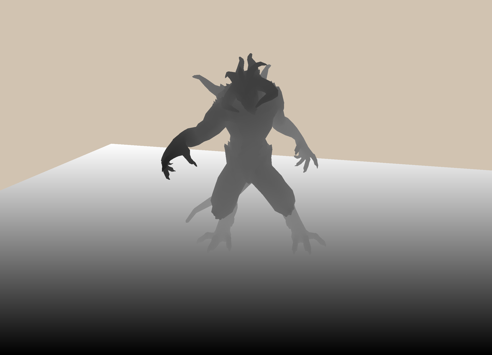](docs/screenshots/depth.png?raw=true)

### 多重采样抗锯齿

**左侧为 1× 单采样，右侧为 4× MSAA。** 两侧取自同一机位、同一分辨率的飞行头盔，截取轮廓上相同的 96 × 64 像素，以最近邻放大 6 倍。观察皮革斜边与浅色背景之间的过渡。

[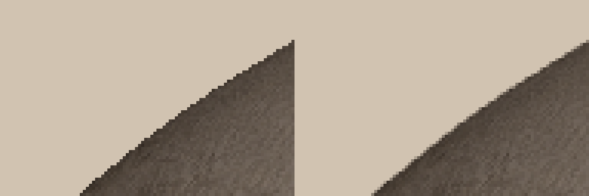](docs/screenshots/helmet-msaa-detail.png?raw=true)

默认 `--msaa 1` 在像素中心采样。`--msaa 4` 在每个像素内的四个位置分别判断三角形覆盖和深度。每个三角形在该像素的覆盖重心执行一次片元着色，颜色写入通过深度测试的样本。最终帧取四个样本的颜色平均值。共享边使用左上填充规则，面积小于一个像素的三角形只要命中采样点也能显示。

MSAA 作用于相机的三角形填充。深度预览按样本着色后合成，AO 和 Sobel 描边读取最近可见样本的深度。纹理缩小时可搭配 `--filter trilinear`。Bresenham 线框和光源深度图使用各自的单采样路径。

```powershell
& $exe --scene helmet --mode pbr --size 2160x1560 --msaa 4 --output helmet-msaa4.tga
```

**飞行头盔 · 4× MSAA 全图**（[打开同机位 1× 原图](docs/screenshots/helmet.png?raw=true)）

[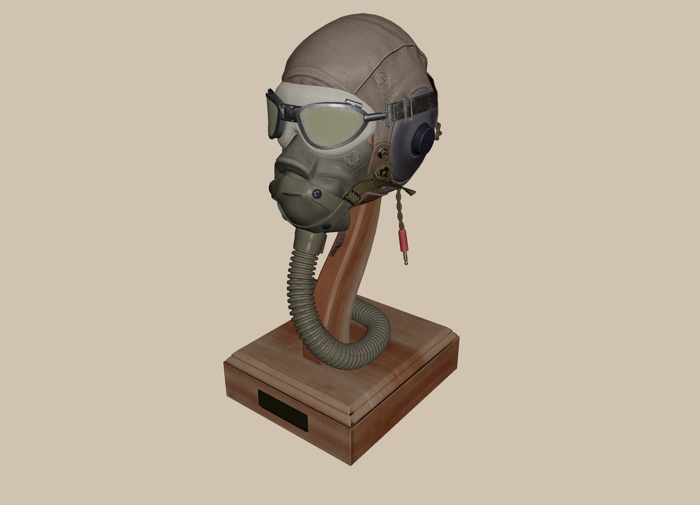](docs/screenshots/helmet-msaa4.png?raw=true)

### 光照与法线

Flat 每个三角形共用一个面法线，鼻梁和下颌的分面尤其明显。Gouraud 插值顶点的光照强度，`smooth` 在每个像素上归一化插值法线，再计算漫反射。三张法线图保持同一机位，将最终参与光照的世界空间法线编码为 RGB，便于检查眼窝、嘴唇和皮肤细节。

**Flat**

[](docs/screenshots/flat.png?raw=true)

**Gouraud**

[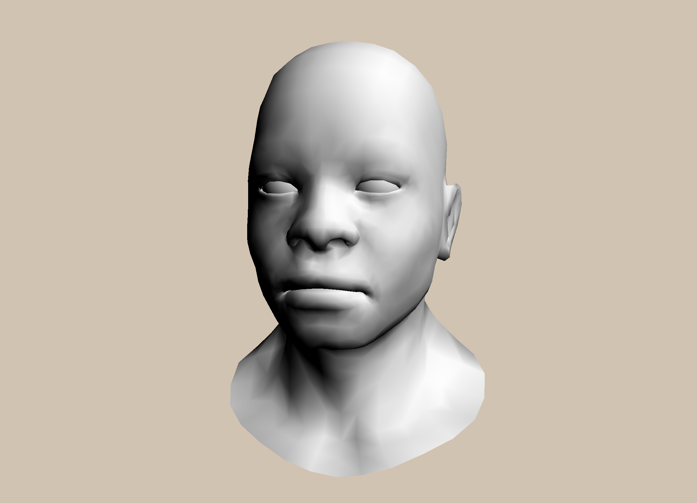](docs/screenshots/gouraud.png?raw=true)

**逐像素漫反射**

[](docs/screenshots/smooth.png?raw=true)

**顶点法线**

[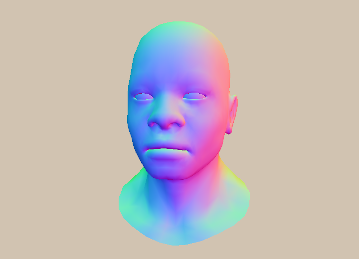](docs/screenshots/normal-vertex.png?raw=true)

**物体空间贴图**

[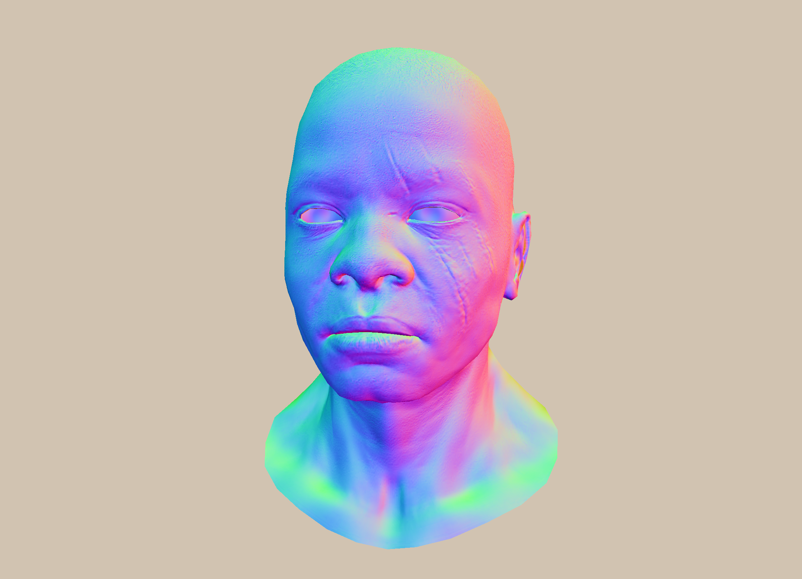](docs/screenshots/normal-object.png?raw=true)

**切线空间贴图**

[](docs/screenshots/normal-tangent.png?raw=true)

### 材质、阴影与 AO

对没有 MTL 的 OBJ，加载器按同名后缀寻找 `_diffuse.tga` 或 `_diff.tga`、`_spec.tga`、`_nm.tga`、`_nm_tangent.tga` 和 `_glow.tga`。有 MTL 时可读取各面的材质及其贴图，包括 `map_Ke`。默认法线来源 `auto` 依次选择切线空间贴图、物体空间贴图、顶点法线。显式指定的贴图缺失时回退到顶点法线。

**漫反射贴图**

[](docs/screenshots/albedo.png?raw=true)

**自发光贴图**

[](docs/screenshots/emission.png?raw=true)

**光照合成，关闭阴影**

[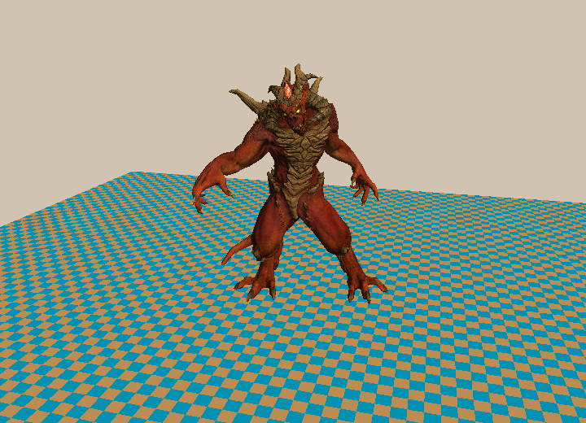](docs/screenshots/lit.png?raw=true)

将页首的 Diablo 投影阴影图与上方关闭阴影的合成图对照，可以观察角色在脚下和身后留下的投影。`shadow` 和 `lit` 使用同一套材质与光照参数。AO 调制环境光，自发光独立叠加。

### 方向光阴影过滤

下图截取 Diablo 爪部落在棋盘地面上的投影。**左列是硬阴影，右列是 3×3 PCF。上排使用 2048² 阴影图，下排使用 4096² 阴影图。** 四块均取自 2160 × 1560 全图的同一处 96 × 64 像素，以最近邻放大 6 倍。沿爪尖观察，PCF 让明暗之间出现过渡。阴影图边长加倍后，同一个 3×3 采样窗口覆盖的地面范围减半，细小爪尖的投影更清晰。

[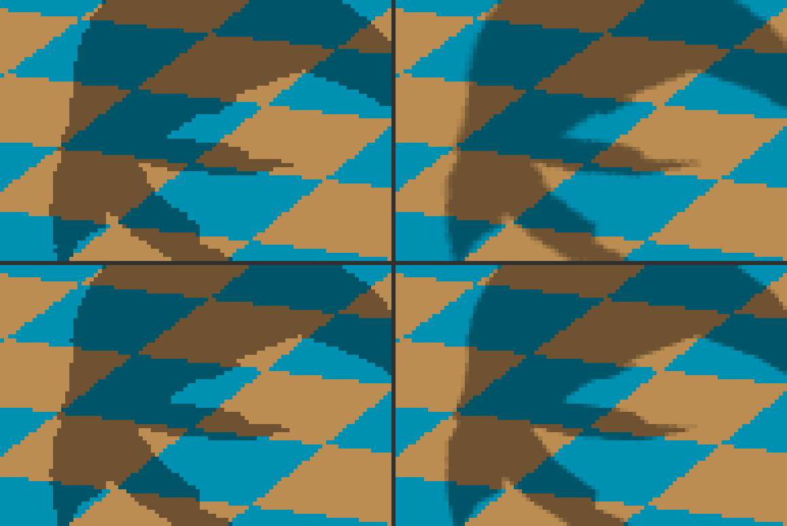](docs/screenshots/shadow-filter-detail.png?raw=true)

**脚掌接地处。** 从左到右依次为默认硬阴影、2048² PCF 和 4096² PCF。角色最低顶点与地面均在 `y = −1`。下图从原图左上角坐标 (864, 1064) 截取 96 × 64 像素，包含该顶点。将模型三角形沿光线方向投到地面，理论投影覆盖了窗口内 751 个可见地面像素。将其中与关闭阴影时颜色完全相同的像素计为完全漏光，三种设置分别有 **6、0、2 个**这样的像素。2048² 的过渡也更宽，可以沿爪尖左侧观察。

[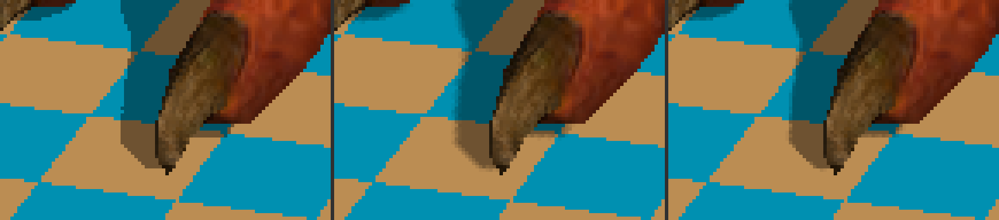](docs/screenshots/shadow-contact-detail.png?raw=true)

`--shadow-size N` 创建边长为 `N` 的正方形阴影图，支持 1 到 8192 的整数。默认 `auto` 将输出宽、高分别乘以四。`--shadow-filter hard` 是默认模式，每个片元比较一次深度。`pcf` 在相邻的九个纹素中心分别比较深度，再根据被遮挡的比例调整漫反射和高光。接收面的三角形提供深度斜率，以便在斜面上对准各采样位置。图边缘的采样限制在最外层纹素，光源视锥外按受光处理。

```powershell
& $exe --scene diablo --mode shadow --size 2160x1560 --shadow-size 2048 --shadow-filter pcf --output shadow-pcf.tga
```

**阴影图内存与单次出图耗时。** 在 Ryzen 7 9700X 上使用 Windows Release x64 渲染同一 Diablo 场景，输出 2160 × 1560，关闭 AO，使用单采样。每组先预热一次，随后轮换配置各运行五次，表中取中位数。耗时包含进程启动、模型加载、两遍渲染和 TGA 写盘。内存一栏只计算方向光深度图，每个纹素占 4 字节。

| 阴影图 | 深度图内存 | 硬阴影 | 3×3 PCF |
| --- | ---: | ---: | ---: |
| 2048 × 2048 | 16 MiB | 338 ms | 369 ms |
| 4096 × 4096 | 64 MiB | 460 ms | 476 ms |
| 8640 × 6240（`auto`） | 205.7 MiB | 764 ms | 803 ms |

**2048² · 硬阴影**

[](docs/screenshots/shadow-2048-hard.png?raw=true)

**2048² · 3×3 PCF**

[](docs/screenshots/shadow-2048-pcf.png?raw=true)

<details>
<summary>展开 4096² 阴影图的两张完整渲染</summary>

**4096² · 硬阴影**

[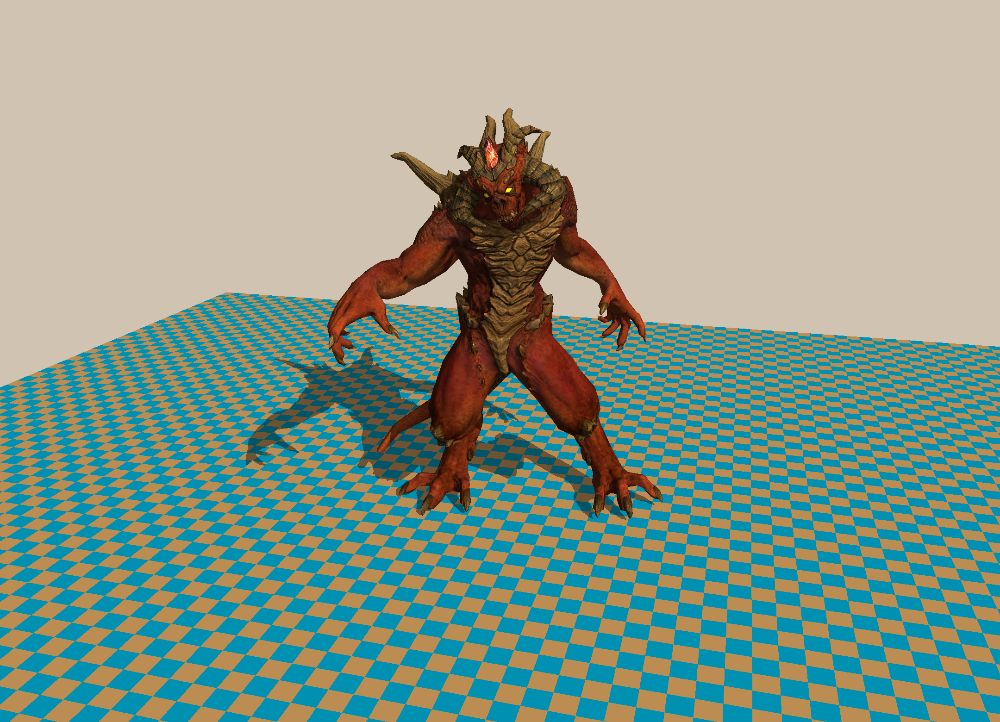](docs/screenshots/shadow-4096-hard.png?raw=true)

**4096² · 3×3 PCF**

[](docs/screenshots/shadow-4096-pcf.png?raw=true)

</details>

### 环境遮蔽

下面两组大图依次展示 SSAO 和多方向 AO 的合成结果与可见度，白色表示开放、暗部表示遮蔽。

**SSAO · 每像素 128 个半球样本 · 最终帧**

[](docs/screenshots/ssao.png?raw=true)

**SSAO · 每像素 128 个半球样本 · 可见度**

[](docs/screenshots/ssao-map.png?raw=true)

**多方向 AO · 256 张半分辨率深度图 · 最终帧**

[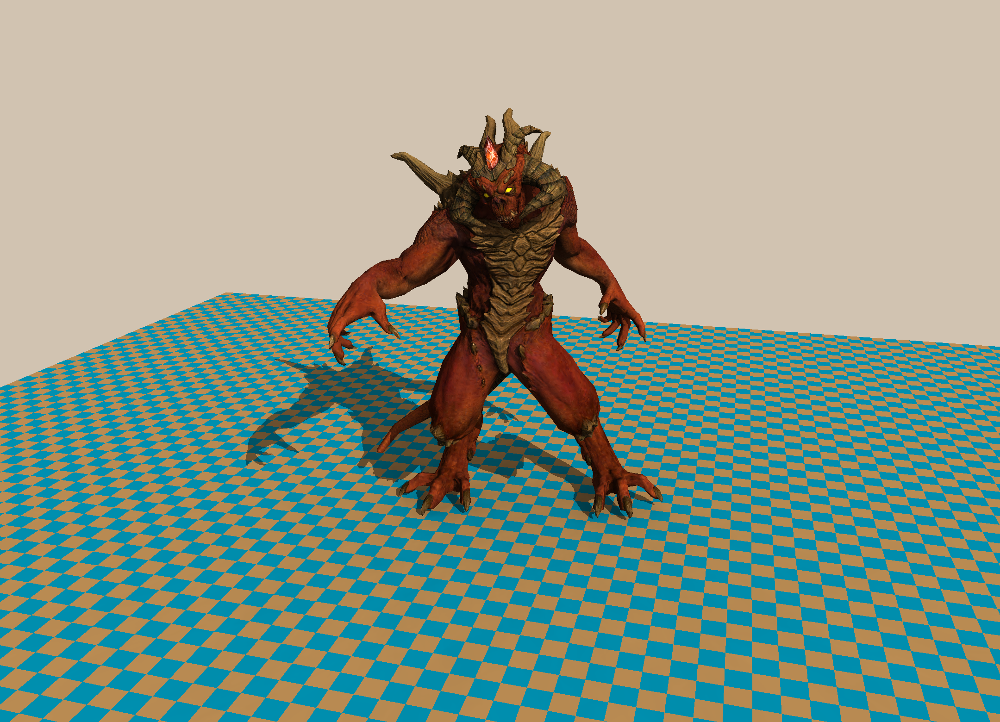](docs/screenshots/brute.png?raw=true)

**多方向 AO · 256 张半分辨率深度图 · 可见度**

[](docs/screenshots/brute-map.png?raw=true)

SSAO 只利用相机当前可见的几何，多方向 AO 还会计入镜头外落在采样视锥内的遮挡物。两种方法均使用有限样本。预设适用于静态场景，方向光和多方向 AO 的正交采样范围针对原点附近的模型设置。

### 纹理过滤

用 Diablo 的棋盘地面观察过滤效果。放大原图看前景格子的边缘，再看远处密集的格子。下面三张图和上方的「漫反射贴图」采用相同的相机、材质和分辨率，只改变采样方式。

| `--filter` | 采样方式 |
| --- | --- |
| `nearest`（默认） | 在原始贴图中取一个纹素。 |
| `bilinear` | 在原始贴图中按距离混合四个相邻纹素，支持跨平铺接缝插值。 |
| `mipmap` | 选最接近目标 LOD 的一层，在该层内做双线性过滤。 |
| `trilinear` | 分别对相邻两层做双线性过滤，再按小数 LOD 混合，使层级切换连续。 |

缩小时，光栅器从裁剪后的三角形计算透视校正的 UV 梯度，用两个屏幕方向中较大的纹素覆盖长度选择 LOD。每张贴图使用自己的尺寸。首次需要低分辨率层时，程序按面积加权生成 mip 链，直至 1 × 1；奇数宽高的边缘纹素也参与平均。放大时，两种 mipmap 模式都使用第 0 层。默认过滤沿用贴图的通道数值。HDR 模式在线性光空间过滤颜色贴图，法线贴图在着色时重新归一化。

```powershell
& $exe --scene diablo --mode albedo --filter trilinear --size 2160x1560 --output trilinear.tga
```

**双线性 · 原始贴图**

[](docs/screenshots/albedo-bilinear.png?raw=true)

**Mipmap · 最近层级**

[](docs/screenshots/albedo-mipmap.png?raw=true)

**三线性 · 相邻层级混合**

[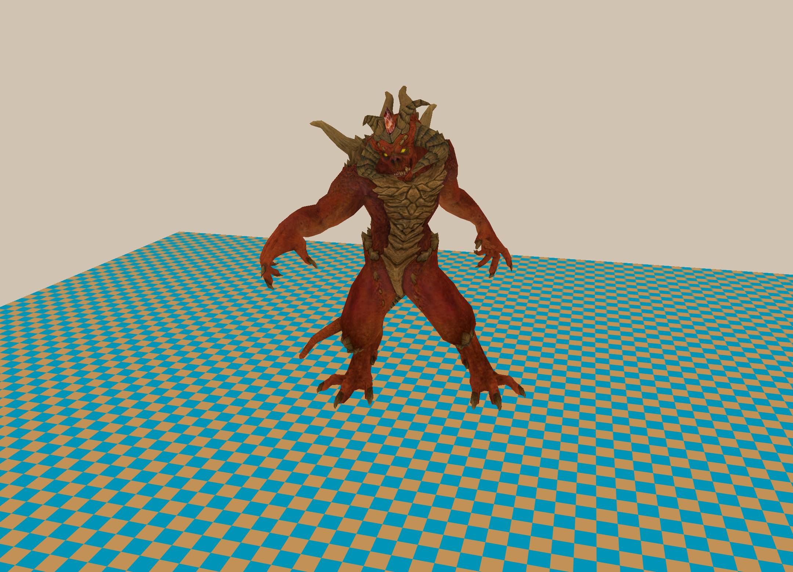](docs/screenshots/albedo-trilinear.png?raw=true)

### HDR、曝光与 Bloom

下图固定 Diablo 的相机、材质、2048² PCF 阴影和 0 EV 曝光。从左到右，自发光强度依次为 **1×、8×、64×、64× 加 Bloom**。前三幅中，额头晶体和眼睛逐渐变亮，晶体里的纹路仍能分辨。第四幅只开启 Bloom，金黄色光晕扩散到眼眶和周围鳞片。四幅都截取全图的同一处 188 × 188 像素，放大两倍。

[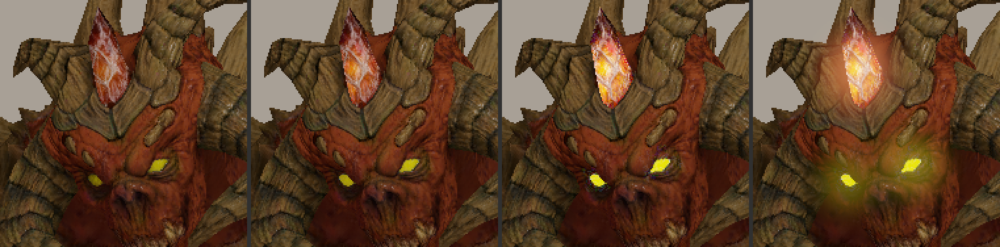](docs/screenshots/hdr-bloom-detail.png?raw=true)

| 参数 | 含义 | 默认值 |
| --- | --- | --- |
| `--hdr` | 开启线性浮点颜色管线。指定下面任一参数也会启用。 | 关闭 |
| `--exposure EV` | 曝光补偿，范围 −16 到 +16。每提高 1 EV，进入色调映射的线性值翻倍。 | 0 EV |
| `--emission-strength N` | 自发光贴图在线性空间的亮度倍率，范围 0 到 1024。 | 1 |
| `--bloom N` | 泛光叠加强度，范围 0 到 16。设为 0 跳过泛光计算。 | 0 |

底色和自发光纹素先经过 sRGB 解码，再做双线性过滤与 mip 层平均。法线、高光强度及打包的 AO、粗糙度和金属度按数据通道采样。光照结果写入浮点 RGB 缓冲，4× MSAA 先平均可见样本的线性颜色。归一化的 sRGB 编解码采用分段传递函数。[sRGB 传递函数](https://www.w3.org/TR/css-color-4/#predefined-sRGB)

Bloom 从合成后的可见像素提取线性亮度超过 1 的部分，在半分辨率图上做水平和垂直高斯模糊，双线性上采样后叠回场景。曝光作用于整个合成结果，各颜色通道通过 Reinhard 曲线 `x / (1 + x)` 压缩，再编码为 8 位 sRGB。窗口与 TGA 使用同一输出。灰度、描边等显示效果在此之后执行。深度、法线、重心和线框诊断图保留各自的输出编码。

```powershell
& $exe --scene diablo --mode shadow --shadow-size 2048 --shadow-filter pcf --hdr --emission-strength 64 --bloom 1 --size 2160x1560 --output bloom.tga
& $exe --scene helmet --mode pbr --exposure -1 --output helmet-minus1.tga
```

**Diablo · 64× 自发光、0 EV、Bloom 强度 1**

[](docs/screenshots/hdr-bloom.png?raw=true)

<details>
<summary>展开同机位的三档自发光及曝光对照全图</summary>

**1× 自发光 · 0 EV**

[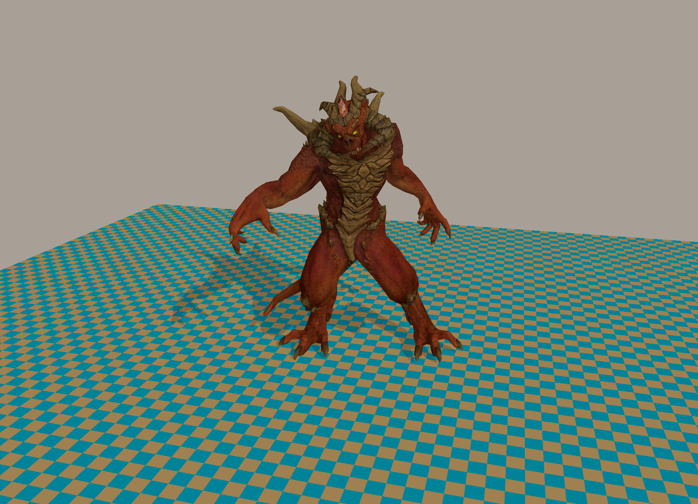](docs/screenshots/hdr-emission-1.png?raw=true)

**8× 自发光 · 0 EV**

[](docs/screenshots/hdr-emission-8.png?raw=true)

**64× 自发光 · 0 EV**

[](docs/screenshots/hdr-emission-64.png?raw=true)

**64× 自发光 · −2 EV** · 相同光照下，进入色调映射的亮度降至上一幅的四分之一。

[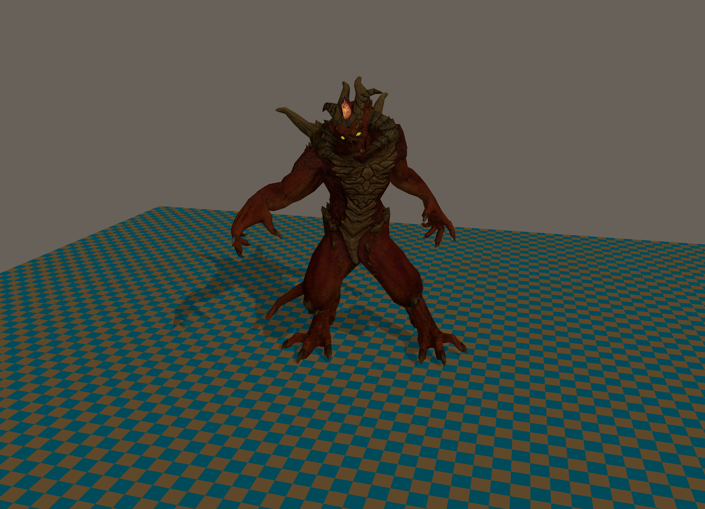](docs/screenshots/hdr-exposure-minus2.png?raw=true)

</details>

**Flight Helmet · PBR、0 EV** · 头盔的 GGX 光照也经过同一条 HDR 输出管线。

[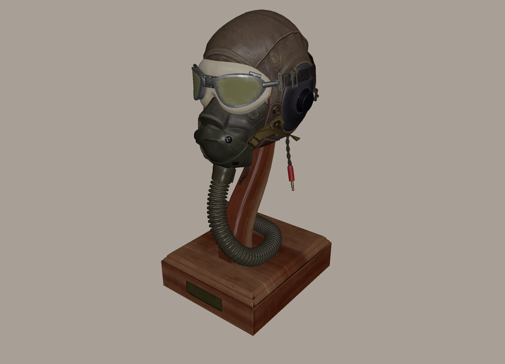](docs/screenshots/helmet-hdr.png?raw=true)

### 卡通与后处理

依次展示三档色带、在深度突变处叠加墨线后的效果，以及对阴影场景应用马赛克的结果。`--post` 也支持 `gray` 和 `rgb`。Flight Helmet 使用项目原有的 GGX 材质和打包的遮蔽、粗糙度、金属度贴图，效果见页首。

**三档色带**

[](docs/screenshots/bands.png?raw=true)

**Sobel 深度描边**

[](docs/screenshots/toon.png?raw=true)

**马赛克**

[](docs/screenshots/mosaic.png?raw=true)

## 复现截图与测试

在仓库根目录运行以下命令。画廊脚本调用同一个可执行文件导出 TGA，再用 Pillow 无损转为 PNG。回归测试覆盖 OBJ 遮挡顺序、近裁剪面、两种填充路径的像素一致性、共享边归属、子像素覆盖与逐样本深度、法线贴图坐标系、灰度纹理、自发光、阴影图尺寸、PCF 的遮挡比例与斜面深度比较、首帧 AO、卡通描边、线性颜色过滤、高光曝光、HDR 多重采样合成与遮挡后的 Bloom。

```powershell
python -m pip install Pillow
python tests/render_smoke.py -v
python tools/gallery.py
```

渲染循环和 AO 计算位于 [Renderer.cpp](SoftRenderer/src/renderer/Renderer.cpp)，材质加载位于 [Model2.cpp](SoftRenderer/src/model2/Model2.cpp)，公共法线解码位于 [Shader.cpp](SoftRenderer/src/shader/Shader.cpp)。人头像由 Vidar Rapp 提供，Flight Helmet 由 Microsoft 提供，原始资源说明随模型保存。[人头像授权说明](SoftRenderer/resource/models/head/readme.txt) · [Flight Helmet 资源说明](SoftRenderer/resource/models/FlightHelmet/README.md)
